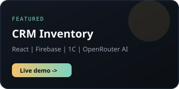
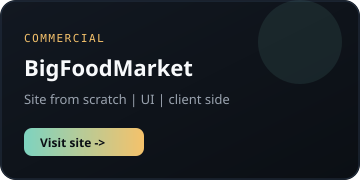
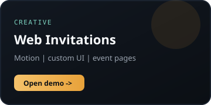

<!--
  GitHub Profile README for https://github.com/Vitali-lab
  Repo must be named exactly: Vitali-lab/Vitali-lab (public)
-->

  <picture>
    <source media="(prefers-color-scheme: dark)" srcset="./assets/typing-dark.svg">
    <source media="(prefers-color-scheme: light)" srcset="./assets/typing-light.svg">
    
  </picture>

  <picture>
    <source media="(prefers-color-scheme: dark)" srcset="./assets/divider-dark.svg">
    
  </picture>

  
  
  

---

### About

Frontend-разработчик с коммерческим опытом. Собираю и поддерживаю интерфейсы на **JavaScript / TypeScript / React**, делаю адаптивную вёрстку, рефакторинг и интеграцию API.

В работе опираюсь на существующую архитектуру, Git-процесс и AI-инструменты — для анализа, написания, отладки и ускорения поставки.

**Сейчас:** коммерческая разработка BackOffice и SiteCMS в **Autobus1**.  
**Параллельно:** собственные продукты на React + Firebase с AI через OpenRouter.

---

### Stack

  

| Area | Tools |
| --- | --- |
| **Frontend** | JavaScript, TypeScript, React, Redux, HTML5, CSS3, SCSS, adaptive UI |
| **Backend / data** | Node.js, Express, Firebase, Firestore, MongoDB, REST API |
| **Enterprise UI** | Razor, CSHTML, Kendo UI |
| **AI** | OpenRouter API, Cursor, ChatGPT, Claude, Gemini, DeepSeek |

---

### Experience

#### Autobus1 — Frontend Developer
`2025 — 2026`

Коммерческая разработка и поддержка внутренних веб-приложений **BackOffice** и **SiteCMS**.

- UI: формы, таблицы, компоненты, интерактивные сценарии
- Рефакторинг JavaScript / TypeScript и поддержка текущей архитектуры
- Адаптивная вёрстка, локализация, фиксы и оптимизация UX
- Git: ветки, code review, Pull Request

`JavaScript · TypeScript · HTML · CSS/SCSS · Razor · CSHTML · Kendo UI · Git`

---

### Featured work

  
  &nbsp;
  

  

| Project | What I built | Link |
| --- | --- | --- |
| **CRM учёта товаров** | React + Firebase CRM, обмен с 1С, AI-аналитика через OpenRouter | [vitali-20776.web.app](https://vitali-20776.web.app/) |
| **BigFoodMarket** | Сайт с нуля: структура страниц и клиентский UI | [bigfoodmarket.by](https://bigfoodmarket.by/) |
| **Web invitations** | Интерактивные приглашения с анимациями и кастомным дизайном | [demo](https://gangsters-night-invitation.netlify.app/) |

---

### AI in my workflow

Использую AI не как «магию», а как рабочий контур:

- анализ и рефакторинг кода
- отладка и ускорение рутины
- ТЗ и контекстные промпты для агентов
- встраивание AI-моделей в продуктовые фичи

`Cursor · ChatGPT · Claude · Gemini · DeepSeek · OpenRouter`

---

### Education

- **РЭУ им. Г. В. Плеханова** (Москва) — высшее образование
- **Result University** — Junior Frontend / Junior Middle
- **IBA** — конфигурирование и программирование **1С:Предприятие 8.3**

---

### GitHub

  
  

---

  <strong>Open to frontend roles and product collaborations.</strong> 
  <a href="https://github.com/Vitali-lab">github.com/Vitali-lab</a>

  

